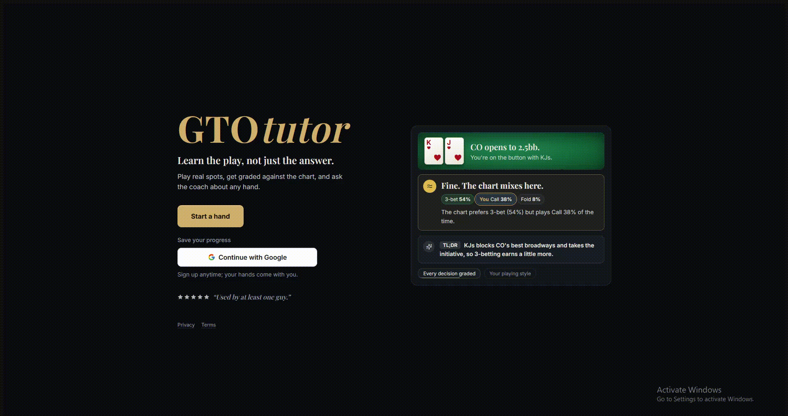
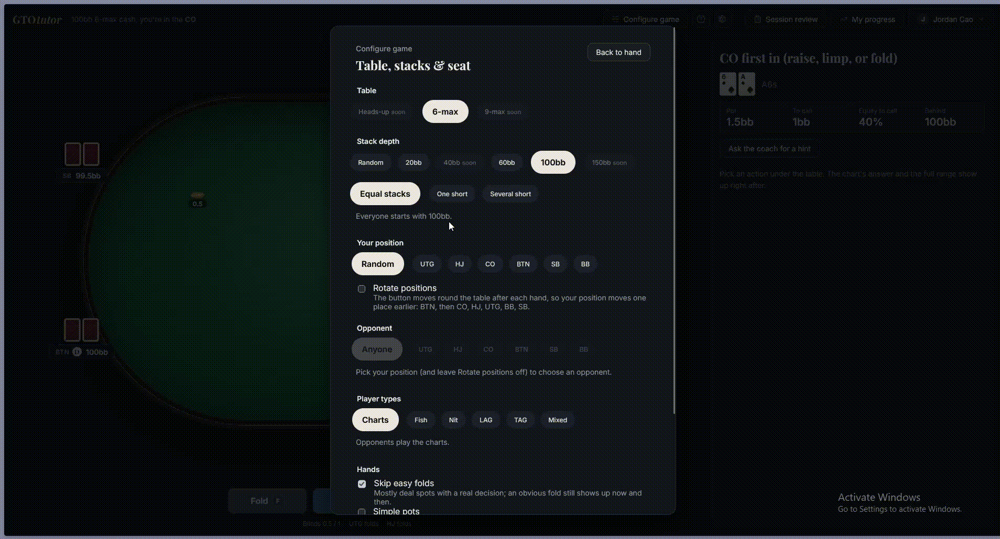
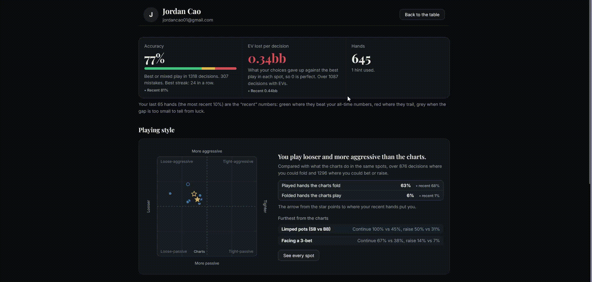

# [GTOtutor - An app made for people learning to play poker](https://gtotutor.app/) 

I absolutely love playing poker, I think its a great mix of strategy with elements of logical reasoning, intuition, mathematical concepts, and social deduction. 

The only thing is that it's kind of a pain to learn. Most tools out there right now  are made for regs or pros who already have a good idea of what they're doing and just need help in very specific or niche positions, plus its not super intuitive for beginners to look at solver. So I decided to make an app that allows users to play out hypothetical hands 
in various positions and stack sizes so that they can develop a good grasp of the game with GTO (game theory optimal) charts so that they know whether they're making the most correct plays. 

In addition, many times the solver doesn't make much sense and good players can understand the meaning behind certain decisions but most people cannot, so I implemented an AI coach which you can ask questions to and develop a better understanding of poker thinking. 

## Features
- Heads-up and 6-max table configurations with target 1% accuracy for live turn/river solves (runs on AWS lambda)
- AI coach (powered by Claude) that can analyze decisions, answer any question pertaining to poker, and understand player leaks
- Style chart: places you on loose/tight x passive/aggressive from your own played hands (all hands vs most recent 10% of hands)
- Opponent archetypes using JEV AI (tight, nit, passive, fish)
- Fully customizable position and stack configurations 
- Fully functional on mobile

## Note: 
- The postflop solves uses [b-inary's postflop-solver] (https://github.com/b-inary/postflop-solver\)
- Preflop solver is my own Rust code
